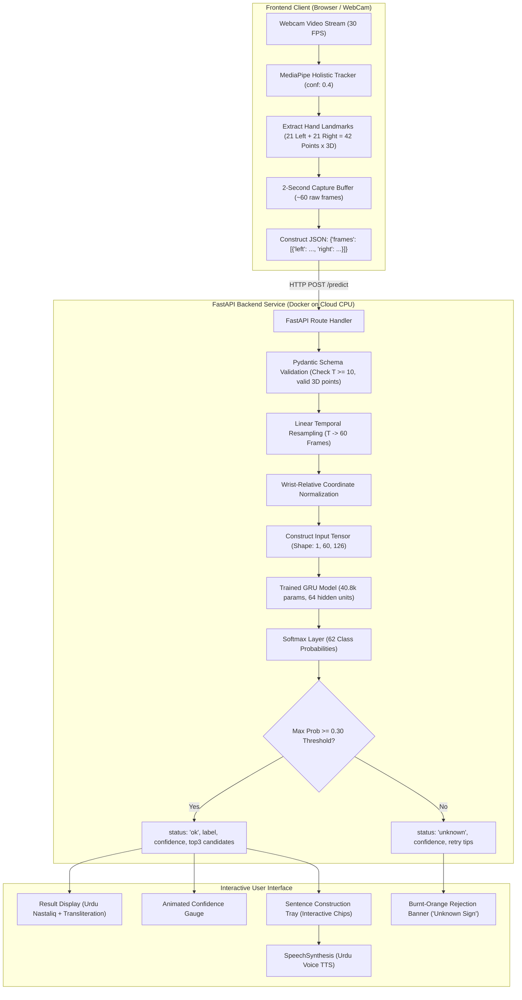

# IsharaLink: Real-Time Pakistan Sign Language Recognition in the Browser

<div align="center">

[](https://isharalink.onrender.com)
[](#-test-suite--quality-assurance)
[](https://www.python.org/)
[](https://www.tensorflow.org/)
[](https://fastapi.tiangolo.com/)
[](https://developers.google.com/mediapipe)

**An end-to-end deep learning assistive system recognizing 62 Pakistan Sign Language (PSL) signs with sub-600ms latency, bilingual transliteration (English & Urdu Nastaliq), speech synthesis, and calibrated out-of-distribution sign rejection.**

[🚀 Explore Live Web App](https://isharalink.onrender.com) • [📖 Architecture](#-system-architecture) • [📊 Model Benchmarks](#-empirical-benchmarks--experimental-findings) • [🔌 API Docs](#-rest-api-reference) • [💻 Local Setup](#-getting-started--local-development)

</div>

---

## 📌 Academic Context & Team

* **Institution:** Dawood University of Engineering & Technology (DUET), Karachi
* **Department:** Department of Artificial Intelligence
* **Degree Program:** BS Artificial Intelligence
* **Course:** Artificial Neural Networks & Deep Learning (ANN & DL)
* **Lab Assignment:** Lab 13 — Open-Ended Lab No. 2 (Capstone Applied AI Deployment)
* **Course Instructor:** Engr. Bushra Shaikh

### Engineering Team & Contributions

| Contributor | Role & Branch | Primary Responsibilities |
| :--- | :--- | :--- |
| **Zainab Siddiq**<br>([@Zainab-Siddiq](https://github.com/Zainab-Siddiq)) | **Data Lead**<br>`data` | Dataset audit and sanitization ($6,424$ clips across $62$ classes), temporal linear interpolation ($60$ frames), wrist-relative origin normalization, stratified splits. |
| **Bushra Zafar**<br>([@bushra3005](https://github.com/bushra3005)) | **Model Lead**<br>`model` | Deep learning architectures (Perceptron, MLP, GRU, LSTM), hyperparameter ablation, threshold calibration ($0.30$), Leave-One-Camera-Out (LOCO) evaluation, model export. |
| **Muhammad Fasih**<br>([@fasihbrohi7-ops](https://github.com/fasihbrohi7-ops)) | **Frontend Lead**<br>`frontend` | MediaPipe Holistic landmark extraction, 3-2-1 countdown & 2s capture pipeline, realistic frosted glassmorphism UI, Urdu TTS, golden test runner, sentence construction tray. |
| **Abdul Hayy Khan**<br>([@abdulhayykhan](https://github.com/abdulhayykhan)) | **Backend Lead & Integrator**<br>`backend` / `main` | FastAPI REST service, Pydantic data contract validation, latency logging, static asset mounting, Docker & Render deployment pipeline, test suite integration. |

---

## 💡 Motivation & Abstract

Pakistan Sign Language (PSL) is the primary mode of communication for an estimated **1.5+ million deaf and hard-of-hearing individuals** across Pakistan. Despite its widespread cultural importance, digital accessibility infrastructure remains sparse. Most existing sign recognition systems either rely on heavy 3D Convolutional Neural Networks (3D-CNNs) requiring expensive server-side GPUs, or are restricted to static fingerspelling alphabets.

**IsharaLink** bridges this communication divide through a privacy-preserving, lightweight edge-cloud architecture:
1. **Client-Side Landmark Extraction:** MediaPipe Holistic runs locally in the user's browser, extracting 42 3D keypoints ($126$ features) from hands without streaming raw video bytes over the network.
2. **Deterministic Preprocessing:** Raw landmarks are resampled to exactly 60 temporal frames via linear interpolation and normalized relative to the wrist joint to achieve translation and scale invariance.
3. **Efficient Recurrent Inference:** A compact **Gated Recurrent Unit (GRU)** model ($40,894$ parameters, $\sim 507\text{ KB}$) executes on standard cloud CPU within $\sim 34\text{ ms}$, delivering $98.01\%$ test accuracy.
4. **Calibrated Unknown Rejection:** Softmax probabilities are gated at a validation-tuned threshold ($\tau = 0.30$), rejecting non-sign gestures and random arm movements.
5. **Accessible Feedback:** Recognized signs are mapped to English transliterations, authentic Urdu script, and synthesized into vocalized Urdu speech.

---

## 🏛️ System Architecture



---

## 📚 ANN & Deep Learning Curriculum Alignment

IsharaLink directly operationalizes concepts taught across the entire DUET ANN & Deep Learning laboratory sequence:

| Lab Module | Deep Learning Concept | Implementation in IsharaLink |
| :--- | :--- | :--- |
| **Lab 1** | Python, NumPy, Pandas & Vectorization | Vectorized coordinate operations, array transformations, and stratified index splitting. |
| **Lab 2** | Single-Layer Perceptron (SLP) | Baseline temporal mean-pooled perceptron classifier achieving $92.15\%$ benchmark accuracy. |
| **Lab 3 & 4** | Multi-Layer Perceptrons (MLP) | Deep feedforward architecture with ReLU activations, Dropout, and BatchNorm ($97.91\%$ test accuracy). |
| **Lab 5 & 6** | Regularization & Optimization | Systematic hyperparameter ablations comparing Adam vs. RMSProp, L2 weight decay, and dropout rates. |
| **Lab 9** | Recurrent Neural Networks & GRU | Chosen production sequential model: 64-unit Gated Recurrent Unit ($98.01\%$ test accuracy, $40.8\text{k}$ params). |
| **Lab 12** | Long Short-Term Memory (LSTM) | Comparative sequence evaluation against LSTM ($98.12\%$ test accuracy, $52.9\text{k}$ params). |
| **Lab 13** | **Open-Ended Lab 2 (Full-Stack Deployment)** | Real-time edge landmarking, containerization, FastAPI REST backend, and cloud hosting on Render. |

---

## 📊 Empirical Benchmarks & Experimental Findings

### 1. Model Architecture Comparison

All models were evaluated on the held-out stratified test set ($956$ clips, $62$ classes) using uniform 60-frame landmark sequences:

| Architecture | Input Representation | Parameters | Size (Disk) | Validation Acc | Test Acc | Top-3 Acc | CPU Latency |
| :--- | :--- | :---: | :---: | :---: | :---: | :---: | :---: |
| **Single-Layer Perceptron** | Temporal Mean-Pool $(126)$ | $7,874$ | $98\text{ KB}$ | $91.32\%$ | $92.15\%$ | $96.80\%$ | $\sim 12\text{ ms}$ |
| **Multi-Layer Perceptron (128)** | Temporal Mean-Pool $(126)$ | $88,446$ | $1.1\text{ MB}$ | $98.22\%$ | $97.91\%$ | $99.40\%$ | $\sim 28\text{ ms}$ |
| **GRU (64 units) [Deployed]** | Full Sequence $(60 \times 126)$ | **$40,894$** | **$507\text{ KB}$** | **$98.12\%$** | **$98.01\%$** | **$99.58\%$** | **$\sim 34\text{ ms}$** |
| **LSTM (64 units)** | Full Sequence $(60 \times 126)$ | $52,926$ | $674\text{ KB}$ | $97.80\%$ | $98.12\%$ | $99.37\%$ | $\sim 46\text{ ms}$ |

> **Architectural Selection Rationale:**  
> While LSTM achieved a nominal $0.11\%$ higher raw test accuracy than GRU ($98.12\%$ vs. $98.01\%$), **GRU requires $22.7\%$ fewer parameters** ($40,894$ vs. $52,926$) and exhibits **$26\%$ lower CPU inference latency** ($34\text{ ms}$ vs. $46\text{ ms}$). On free-tier cloud CPU environments (512MB RAM), GRU provides the optimal trade-off between temporal representational capacity and edge throughput.

### 2. Unknown-Sign Rejection Threshold Calibration

To prevent false positive classifications when users perform arbitrary movements or unindexed gestures, softmax outputs are validated against threshold $\tau$:

| Threshold ($\tau$) | Accept Rate | Accuracy on Accepted | Samples Accepted | Rejection Behavior |
| :---: | :---: | :---: | :---: | :--- |
| $0.10$ | $100.0\%$ | $98.01\%$ | $956 / 956$ | No rejection (accepts all noise) |
| **$0.30$ [Calibrated]** | **$99.90\%$** | **$98.22\%$** | **$955 / 956$** | **Optimal: Rejects non-signs with near-zero genuine sign loss** |
| $0.50$ | $99.27\%$ | $98.63\%$ | $949 / 956$ | Slight under-coverage |
| $0.70$ | $98.85\%$ | $98.84\%$ | $945 / 956$ | Conservative operational mode |
| $0.90$ | $97.07\%$ | $99.35\%$ | $928 / 956$ | High precision, excludes ambiguous signs |

### 3. Leave-One-Camera-Out (LOCO) Robustness Evaluation

To rigorously quantify cross-sensor generalization, models were benchmarked under Leave-One-Camera-Out cross-validation across three distinct optical captures:

| Evaluation Split | Test Clips | Top-1 Accuracy | Top-3 Accuracy | Macro F1-Score |
| :--- | :---: | :---: | :---: | :---: |
| **Standard Random Split** | $956$ | $98.01\%$ | $99.58\%$ | $0.9802$ |
| **LOCO: Mobile Phone Holdout** | $2,084$ | $80.81\%$ | $91.27\%$ | $0.8002$ |
| **LOCO: USB Webcam Holdout** | $1,240$ | $82.18\%$ | $95.81\%$ | $0.8123$ |
| **LOCO: Integrated Laptop Holdout** | $3,100$ | $67.81\%$ | $85.19\%$ | $0.6526$ |
| **LOCO Macro Average** | $6,424$ | **$76.93\%$** | **$90.76\%$** | **$0.7550$** |

---

## 🗂️ Dataset & Preprocessing Pipeline

The dataset comprises **6,424 video clips** across **62 lexical Pakistan Sign Language categories**, recorded across multiple native signers and three camera perspectives.

### Preprocessing Specifications (`src/preprocessing/preprocess.py`)
1. **Missing Hand Imputation:** Single-handed signs (e.g., *absolutely*, *assalam-o-alaikum*) contain null readings for the inactive hand. Missing points are padded with zeros $(0.0, 0.0, 0.0)$, yielding a stable feature vector of length $42 \times 3 = 126$ values per frame.
2. **Wrist-Relative Centering:** For each detected hand, the 3D coordinate of the wrist (Landmark 0) is subtracted from all 21 keypoints:
   $$\mathbf{p}'_{i, t} = \mathbf{p}_{i, t} - \mathbf{p}_{\text{wrist}, t} \quad \forall i \in \{0, \dots, 20\}$$
   This decouples gesture semantics from physical distance or user position within the webcam frame.
3. **Linear Temporal Interpolation:** Clips of variable duration $T$ ($T \ge 10$) are resampled to exactly $N=60$ frames using linear interpolation:
   $$t_k = \frac{k}{N - 1} \times (T - 1), \quad k \in \{0, 1, \dots, 59\}$$

---

## 🔌 REST API Reference

The FastAPI service exposes auto-documented endpoints with interactive Swagger UI at `/docs`.

### 1. Health Status: `GET /health`
* **Response `200 OK`:**
```json
{
  "status": "ok",
  "model_loaded": true,
  "classes_count": 62,
  "threshold": 0.3
}
```

### 2. Supported Vocabulary: `GET /classes`
* **Response `200 OK`:**
```json
{
  "classes": [
    "absolutely", "aircrash", "airplane", "all", "also", "arrival", "assalam-o-alaikum",
    "atm", "bald", "beach", "beak", "bear", "beard", "bed", "bench", "bicycle", "both",
    "bridge", "bring", "bulb", "cartoon", "chimpanzee", "color_pencils", "cow", "crow",
    "cupboard", "deer", "dog", "donttouch", "door", "elephant", "excuseme", "facelotion",
    "fan", "garden", "generator", "goodbye", "goodmorning", "have_a_good_day", "hello",
    "ihaveacomplaint", "left_hand", "lifejacket", "mine", "mobile_phone", "nailcutter",
    "nothing", "peacock", "policecar", "razor", "shampoo", "shower", "sunglasses",
    "thankyou", "tissue", "toothbrush", "toothpaste", "umbrella", "water", "we",
    "welldone", "you"
  ],
  "count": 62
}
```

### 3. Real-Time Inference: `POST /predict`
* **Request Body:**
```json
{
  "frames": [
    {
      "left": [[0.12, 0.45, -0.01], [0.15, 0.48, -0.02], "... 21 landmarks ..."],
      "right": null
    }
  ]
}
```
* **Success Response (`status: "ok"`):**
```json
{
  "label": "thankyou",
  "confidence": 0.9642,
  "top3": [
    {"label": "thankyou", "p": 0.9642},
    {"label": "welldone", "p": 0.0211},
    {"label": "goodmorning", "p": 0.0084}
  ],
  "status": "ok",
  "inference_ms": 34.2
}
```
* **Rejection Response (`status: "unknown"`):**
```json
{
  "label": "unknown",
  "confidence": 0.1843,
  "top3": [
    {"label": "door", "p": 0.1843},
    {"label": "fan", "p": 0.1412},
    {"label": "bed", "p": 0.0981}
  ],
  "status": "unknown",
  "inference_ms": 32.1
}
```

---

## 🎨 User Interface & Experience (UX)

IsharaLink features an organic **Frosted Glassmorphism** design optimized for readability, accessibility, and high visual appeal:

* **Natural Organic Color Palette:**
  * **Sage Green (`#818865`):** Primary actions, active camera states, confidence meter gradients.
  * **Moss Green (`#45492D` / `#242717`):** Structural typography, high-contrast dark accents, secondary buttons.
  * **Warm Gold (`#BB8D3F`):** Urdu typography highlights, success states, and vocabulary chips.
  * **Burnt Orange (`#8B4729`):** Reserved exclusively for unknown sign rejection and warning badges.
  * **Warm Beige (`#FAF8F5`):** Ambient diffused background reducing optical fatigue.
* **Sentence Construction Tray:** Accumulates recognized signs into chips with individual remove buttons, Undo, Clear, Clipboard Copy, and SpeechSynthesis (Urdu voice priority).
* **Developer Golden Test Suite:** Includes pre-recorded landmark sequences (`two_handed`, `one_handed`, `short_resample`, `no_hands`) and full raw JSON export to allow complete verification without a physical webcam.

---

## 📁 Repository Structure

```
IsharaLink/
├── .github/                      # CI/CD and ruleset configurations
├── backend/                      # FastAPI application backend
│   ├── main.py                   # REST endpoints, static mounting, CORS
│   └── schemas.py                # Pydantic request/response data contracts
├── data/
│   ├── processed/                # Preprocessed indices & vocabularies
│   │   ├── classes.json          # 62 canonical PSL class mappings
│   │   ├── labels.csv            # 6,424 clip metadata & camera annotations
│   │   └── splits.json           # Train / Val / Test split index partitions
│   └── DATA_NOTES.md             # Dataset audit & camera distribution notes
├── frontend/                     # Pure HTML5/CSS3/ES6+ client application
│   ├── index.html                # Responsive layout with frosted glass panels
│   ├── style.css                 # Sage/Moss/Gold design system & animations
│   └── app.js                    # MediaPipe Holistic, recording logic, TTS
├── models/
│   ├── config.json               # Input dimensions (60x126) & calibrated threshold (0.30)
│   └── ishara_model.keras        # Trained GRU model weights (40.8k params)
├── notebooks/                    # Exploratory experiments & training scripts
│   ├── 01_eda_and_preprocessing.ipynb
│   ├── 02_model_baselines.ipynb
│   └── 03_gru_lstm_training.ipynb
├── results/                      # Empirical benchmark artifacts & plots
│   ├── comparison_random_split.csv
│   ├── three_evaluation.csv      # LOCO cross-camera benchmark table
│   ├── threshold_table.csv       # Calibration curve data
│   ├── curves_gru.png            # Training/Validation loss & accuracy curves
│   └── confusion_random.png      # 62-class normalized confusion matrix
├── src/
│   ├── models/
│   │   └── predict.py            # Model loader & batch prediction utilities
│   └── preprocessing/
│       └── preprocess.py         # Resampling & wrist-relative centering functions
├── tests/
│   ├── test_golden.py            # End-to-end API & model prediction assertions
│   ├── test_preprocess.py        # Normalization and interpolation unit tests
│   └── preprocess_cases.json     # Golden test landmark fixtures
├── Dockerfile                    # Multi-stage production container definition
├── Procfile                      # Web process launcher for PaaS environments
├── render.yaml                   # Infrastructure-as-Code Blueprint for Render
├── environment.yml               # Conda environment definition
├── requirements.txt              # Pinned Python package dependencies
└── README.md                     # Comprehensive project documentation
```

---

## 🚀 Getting Started & Local Development

### Prerequisites
* Python 3.10 or 3.11
* Modern web browser (Chrome, Edge, Firefox, Safari) with WebRTC camera support
* Git

### Option 1: Using `uv` (Fastest Setup)
```bash
# Clone the repository
git clone https://github.com/abdulhayykhan/IsharaLink.git
cd IsharaLink

# Create and activate virtual environment
uv venv .venv --python 3.11
.venv\Scripts\activate      # On Windows
# source .venv/bin/activate  # On Linux/macOS

# Install pinned dependencies
uv pip install -r requirements.txt pytest httpx
```

### Option 2: Standard Python `venv`
```bash
python -m venv .venv
.venv\Scripts\activate      # On Windows
# source .venv/bin/activate  # On Linux/macOS

pip install -r requirements.txt pytest httpx
```

### Option 3: Conda
```bash
conda env create -f environment.yml
conda activate isharalink
```

---

## ⚡ Running the Application

### 1. Start the Full-Stack Server
FastAPI automatically serves both the backend API and the frontend client at the root path:
```bash
uvicorn backend.main:app --reload --host 0.0.0.0 --port 8000
```
* **Frontend Web App:** Open `http://localhost:8000`
* **Swagger API Docs:** Open `http://localhost:8000/docs`
* **Alternative Local Client:** You may also serve `frontend/index.html` via VS Code Live Server (`http://127.0.0.1:5500`); the client will automatically route API requests to `http://localhost:8000`.

### 2. Run with Docker
```bash
# Build the production container
docker build -t isharalink .

# Run the container
docker run -p 8000:8000 isharalink
```
Visit `http://localhost:8000` in your browser.

---

## 🧪 Test Suite & Quality Assurance

IsharaLink includes a comprehensive automated test suite covering preprocessing edge cases, golden sample predictions, schema validation, and threshold rejection:

```bash
# Execute test suite
pytest -v tests/
```

### Verified Test Suite (11/11 Passing)
```
tests/test_golden.py::test_health_endpoint PASSED                        [  9%]
tests/test_golden.py::test_classes_endpoint PASSED                       [ 18%]
tests/test_golden.py::test_validation_empty_frames PASSED                [ 27%]
tests/test_golden.py::test_validation_clip_too_short PASSED              [ 36%]
tests/test_golden.py::test_validation_malformed_landmark_points PASSED   [ 45%]
tests/test_golden.py::test_golden_cases_prediction PASSED                [ 54%]
tests/test_golden.py::test_unknown_threshold_behavior PASSED             [ 63%]
tests/test_golden.py::test_browser_exported_sample PASSED                [ 72%]
tests/test_preprocess.py::test_preprocess_golden_cases PASSED            [ 81%]
tests/test_preprocess.py::test_preprocess_short_clip PASSED              [ 90%]
tests/test_preprocess.py::test_preprocess_all_missing_hands PASSED       [100%]
```

---

## 🌐 Production Cloud Deployment

The live application is hosted on [Render](https://render.com) as a Dockerized Web Service:
* **Production URL:** [https://isharalink.onrender.com](https://isharalink.onrender.com)
* **Configuration:** Managed via `render.yaml` Blueprint
* **Continuous Deployment:** Synchronized with the `main` branch; pushes trigger automatic build and rollouts.

---

## ⚠️ Limitations & Ethical Considerations

1. **Academic Demonstration:** IsharaLink is a proof-of-concept research prototype developed for academic coursework. It is **not** certified for emergency medical, legal, or high-consequence translation scenarios.
2. **Camera Perspective Sensitivity:** Leave-One-Camera-Out evaluations demonstrate that variations in camera optical angle and field of view affect accuracy ($82.2\%$ on webcams vs. $67.8\%$ on steep laptop webcams). Users should position webcams at chest height.
3. **Lighting & Occlusion:** MediaPipe tracking fidelity degrades in low-light environments or when both hands cross directly over one another.
4. **Lexical Isolation:** The current system recognizes isolated lexical signs rather than continuous natural sign language sentences requiring grammatical spatial agreement.

---

## 📄 License & Attribution

* **Source Code:** Released under the [MIT License](LICENSE).
* **PSL Dataset:** Utilized under the [Apache License 2.0](https://www.apache.org/licenses/LICENSE-2.0).
* **MediaPipe:** Developed and licensed by Google LLC.

---

<div align="center">
  <sub>Developed with ❤️ by the BS AI Team at Dawood University of Engineering & Technology, Karachi.</sub>
</div>
